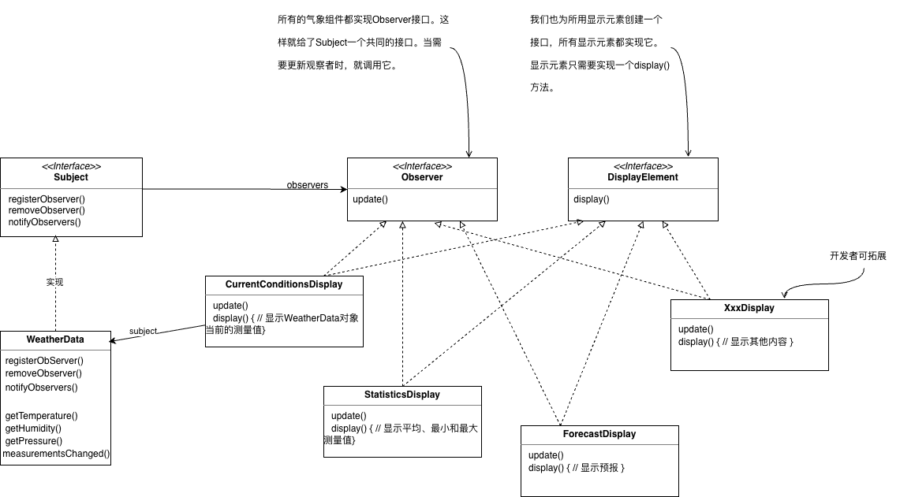
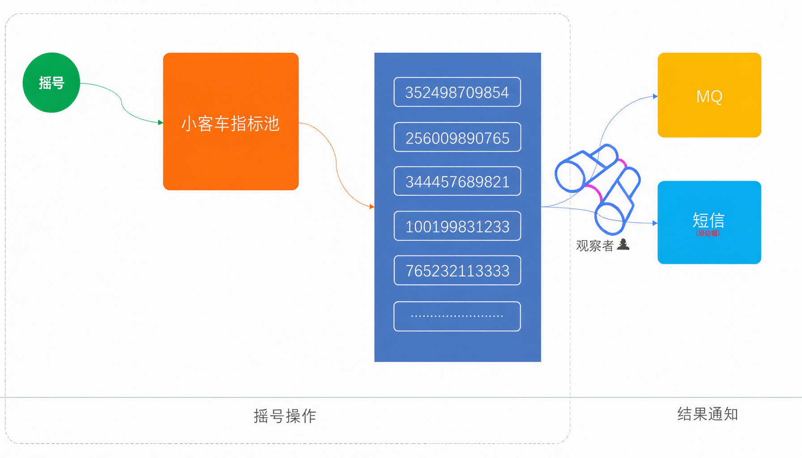
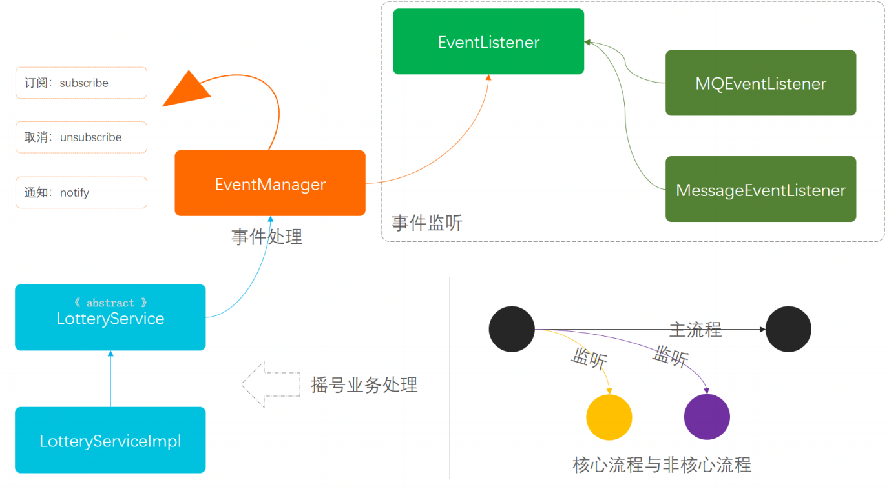

# 观察者模式

就是当一个行为发生时传递信息给另外一个用户接受做出相应的处理，两者之间没有直接的耦合关联。

除了日常生活中的场景，在编程开发中我们也经常使用观察者模式或相关组件。例如常用的 MQ 服务——虽然 MQ
服务设有通知中心，并非由每个类服务逐一进行通知，但整体上也可以视为观察者模式的设计思路。再比如一些事件监听总线，用于将主线服务与其他辅线业务服务解耦，为了降低系统耦合度并增强扩展性，也会采用观察者模式进行处理。

### 简单实现

[WeatherStation](./WeatherStation/WeatherStation.java) -点击跳转

《Head first 设计模式》这本书中对观察者模式的定义如下：

定义对象之间的一对多依赖，这样一来，当一个对象改变状态时，它的所有依赖者都会收到通知并自动更新。

WeatherStation-UML图

原来的版本中天气的数据是自己提供的，该版本中用python写了两个脚本，分别实现了拉取当前时间的天气数据和过去 10 天的逐小时历史天气数据：

- [fetch_weather.py](./WeatherStation/fetch_weather.py)：每 10 秒轮询一次当前天气（温度、湿度、气压），追加写入
  `weather.jsonl`，供实时管道使用。
- [fetch_history.py](./WeatherStation/fetch_history.py)：一次性拉取过去 10 天的逐小时历史数据，覆盖写入
  `weather_history.jsonl`，供历史回放使用。

数据源头是 [Open-Meteo](https://open-meteo.com/) 的免费天气 API。需要注意的是，Open-Meteo
的数据并非气象站实测的真实观测值，而是聚合各国气象机构的数值天气预报模型（如 GFS、ICON 等）推导计算得出的数据，仅供学习演示使用。

### 业务实现

模拟每次小客车指标摇号事件通知场景。
小客车摇号后，结果通过 MQ、短信等渠道通知出去，摇号操作与结果通知互不耦合，观察者负责"盯着"指标池的变化。

#### 用一坨代码实现

[代码实现](./business/simple/LotteryServiceImpl.java)

- 从以上的方法实现中可以看到，整体过程包括三部分；摇号、发短信、发MQ消息，⽽这部分都是顺序调⽤的。

- 除了摇号接⼝调用外，后⾯的两部分都是⾮核⼼主链路功能，⽽且会随着后续的业务需求发展而不断的调整和扩充，在这样的开发⽅式下就非常不利于维护。

#### 观察者模式重构

[代码实现](./business/design/LotteryServiceImpl.java)

模型结构：

- 从上图可以分为三⼤块看：**事件监听**、**事件处理**、**具体的业务流程**，另外在业务流程中`LotteryService` 定义的是抽象类，因为这样可以通过抽象类将事件功能屏蔽，外部业务流程开发者不需要知道具体的通知操作。

- 右下⻆圆圈图表示的是核心流程与非核⼼流程的结构，⼀般在开发中会把主线流程开发完成后，再使⽤通知的⽅式处理辅助流程。他们可以是异步的，在MQ以及定时任务的处理下，保证最终一致性。

[测试类](../../../../../test/java/com/junzhecai/observer/business/design/ApiTest.java)

